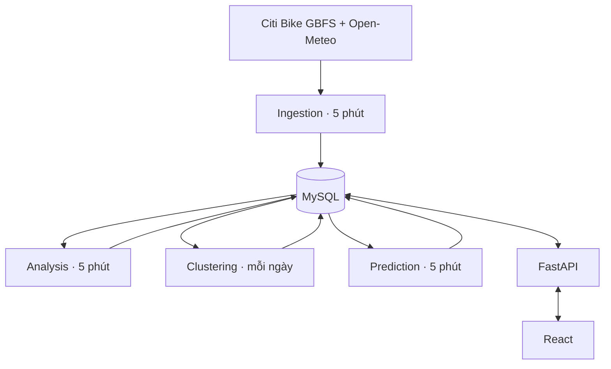

# ĐẶC TẢ YÊU CẦU WEBSITE CITI BIKE NEW YORK FORECAST

> Phiên bản: 3.0 — Ngày: 01/11/2026 (Asia/Bangkok).
> Cập nhật theo sơ đồ khối và cấu trúc thư mục đã thống nhất: React, FastAPI, MySQL và bốn service Python xử lý nền độc lập. Các ngưỡng nghiệp vụ và chỉ tiêu hiệu năng vẫn là giá trị đề xuất để nhóm kiểm chứng.

## 1. Tên đề tài và mục tiêu

**Tên đề tài:** Dự đoán số xe đạp công cộng có thể thuê tại các trạm Citi Bike ở New York trong 30 phút tới dựa trên thời tiết và thời gian.

Website giúp người dùng xem số xe hiện tại, thời tiết tại khu vực trạm và số xe dự đoán sau 30 phút. Nhóm thu thập dữ liệu mỗi 5 phút để tạo dữ liệu lịch sử, vẽ biểu đồ và huấn luyện mô hình dự đoán.

Mục tiêu cụ thể:
- Theo dõi số xe tại các trạm được chọn trên danh sách và bản đồ.
- Kết hợp dữ liệu xe đạp và thời tiết theo vị trí, thời gian.
- Phân tích sự biến động của số xe theo giờ, ngày và điều kiện thời tiết.
- Phân cụm các trạm theo đặc điểm số xe và mức biến động, giúp so sánh các nhóm trạm.
- Dự đoán số xe còn tại từng trạm sau 30 phút.
- Hiển thị cảnh báo trạm có nguy cơ hết hoặc còn ít xe.
- So sánh dự đoán với số xe thực tế khi đến thời điểm cần dự đoán.

**Phân biệt:** Số xe còn tại trạm không phải số lượt thuê. Biến động số xe còn phụ thuộc vào thuê, trả và điều chuyển. Website không suy diễn số lượt thuê chính xác từ chênh lệch hai lần thu thập.

## 2. Phạm vi triển khai

### 2.1. Chức năng bắt buộc của phiên bản đầu

- Theo dõi ban đầu 5–10 trạm; có thể tăng sau khi kiểm tra hạn mức API và khả năng lưu trữ.
- Trang tổng quan, bản đồ/danh sách trạm, chi tiết trạm, phân tích, phân cụm và dự đoán.
- Đủ các khối bắt buộc: Data Source, Data Ingestion, Database, Database API, Front End, Data Analysis, Clustering, Prediction.
- Mỗi khối phần mềm chạy thành service/tiến trình độc lập theo sơ đồ; MySQL là dịch vụ cơ sở dữ liệu riêng. Hai Data Source là dịch vụ bên ngoài.
- Khu vực quản trị để chọn trạm, xem trạng thái thu thập, quản lý cấu hình và mô hình.
- Ingestion thu thập mỗi 5 phút; Analysis phân tích mỗi 5 phút; Prediction tạo dự đoán mỗi 5 phút; Clustering chạy mỗi ngày. Các lịch chạy thuộc backend, hoạt động kể cả khi không mở website.
- Dự đoán duy nhất một khoảng thời gian: 30 phút tới.
- Người xem không cần tài khoản; chỉ quản trị viên phải đăng nhập.

### 2.2. Chức năng mở rộng

- Dự đoán thêm 15 hoặc 60 phút khi đã có dữ liệu và đánh giá riêng.
- Tài khoản người dùng, lưu trạm yêu thích, thông báo theo trạm.
- Nhân viên điều phối với màn hình hỗ trợ lập kế hoạch điều chuyển.
- Gợi ý trạm thay thế gần trạm có nguy cơ hết xe.

### 2.3. Ngoài phạm vi

- Thuê xe, mở khóa xe, đặt giữ xe, thanh toán và quản lý chuyến đi.
- Điều khiển hoặc thay đổi dữ liệu hệ thống xe đạp Citi Bike New York.
- Tự động thực hiện điều chuyển xe ngoài thực tế.
- Cam kết dự đoán luôn đúng hoặc có số đo thời tiết tại cảm biến của từng trạm.

## 3. Tác nhân và phân quyền

| Mã | Tác nhân | Quyền và trách nhiệm |
|---|---|---|
| A01 | Người dùng/người đi xe đạp | Xem tổng quan, tìm và lọc trạm, xem bản đồ, thời tiết, lịch sử, dự đoán và cảnh báo |
| A02 | Quản trị viên | Đăng nhập/đăng xuất; cấu hình trạm theo dõi; kiểm tra thu thập, chất lượng dữ liệu; quản lý phiên bản mô hình và xem đánh giá |
| A03 | Citi Bike GBFS | Hệ thống ngoài cung cấp mã, tên, tọa độ trạm và số xe có thể thuê |
| A04 | Open-Meteo | Hệ thống ngoài cung cấp dữ liệu thời tiết theo tọa độ |
| A05 | Nhân viên điều phối — mở rộng | Xem cảnh báo thiếu xe, dự đoán và danh sách trạm cần ưu tiên |

Cơ sở dữ liệu, mô hình dự đoán và bộ lập lịch thuộc bên trong hệ thống, không phải tác nhân ngoài khi vẽ Use Case với ranh giới là toàn bộ website và backend.

## 4. Danh sách yêu cầu chức năng

| Mã | Chức năng | Mô tả và điều kiện chính |
|---|---|---|
| FR01 | Xem tổng quan | Tổng số trạm theo dõi, số xe hiện có, số trạm ít xe và thời điểm cập nhật; chỉ tổng hợp từ dữ liệu đủ mới, nêu rõ số trạm thiếu dữ liệu |
| FR02 | Xem danh sách trạm | Hiện mã, tên, số xe, thời điểm quan sát gần nhất và trạng thái dữ liệu |
| FR03 | Tìm kiếm và lọc | Tìm theo mã/tên; lọc trạm hết xe, ít xe, có xe, có nguy cơ thiếu xe hoặc dữ liệu cũ |
| FR04 | Xem bản đồ | Hiện vị trí trạm; chọn điểm để mở thông tin trạm; có chú giải màu |
| FR05 | Xem chi tiết trạm | Hiện số xe hiện tại, vị trí, thời tiết, lịch sử và dự đoán tại một trạm |
| FR06 | Xem thời tiết | Hiện nhiệt độ, độ ẩm, lượng mưa và gió; kèm thời điểm dữ liệu và nguồn |
| FR07 | Xem lịch sử | Chọn trạm và khoảng thời gian; xem số xe, nhiệt độ, mưa trên các biểu đồ phù hợp |
| FR08 | Xem dự đoán | Hiện số xe dự đoán sau 30 phút, thời điểm tạo và thời điểm mục tiêu; báo chưa đủ dữ liệu nếu chưa thể dự đoán |
| FR09 | Xem cảnh báo | Hiện cảnh báo dự đoán hết/ít xe; phân biệt cảnh báo dự đoán với tình trạng hiện tại |
| FR10 | Đăng nhập quản trị | Xác thực tài khoản quản trị; chặn truy cập trái phép ở backend |
| FR11 | Chọn trạm theo dõi | Bật/tắt theo dõi từ danh mục nguồn; không sửa số xe thực tế bằng tay |
| FR12 | Thu thập tự động | Backend gọi nguồn dữ liệu theo lịch 5 phút; lưu thời gian và kết quả từng lần chạy |
| FR13 | Quản lý lỗi thu thập | Xem nguồn lỗi, thời gian, số bản ghi thành công/thất bại và lần thành công gần nhất |
| FR14 | Quản lý mô hình | Yêu cầu huấn luyện, xem tiến trình và chỉ số; kích hoạt phiên bản đạt yêu cầu; giữ phiên bản cũ để quay lại |
| FR15 | Đánh giá dự đoán | So sánh dự đoán với thực tế theo trạm, thời gian; hiển thị MAE, RMSE và số mẫu hợp lệ |
| FR16 | Xuất dữ liệu | Quản trị viên xuất CSV theo trạm và khoảng ngày, kèm tên cột, đơn vị và thời gian |
| FR17 | Phân tích định kỳ | Service Analysis đọc quan sát đã hoàn tất, tính thống kê mỗi 5 phút và lưu kết quả vào MySQL |
| FR18 | Phân cụm định kỳ | Service Clustering chạy mỗi ngày, tạo đặc trưng theo trạm, phân cụm và lưu phiên chạy cùng thành viên |
| FR19 | Xem nhóm trạm | Người dùng xem cụm, các trạm trong cụm, đặc trưng, cửa sổ dữ liệu và thời điểm phân cụm gần nhất |
| FR20 | Giám sát service | Quản trị viên xem trạng thái, lần thành công gần nhất, độ trễ và lỗi của cả bốn service nền |
| FR21 | Phục vụ web qua API | FastAPI xử lý các thao tác web và đọc/ghi database; frontend không đọc MySQL trực tiếp |
| FR22 | Xử lý thiếu dữ liệu nền | Không chạy mô hình học máy/phân cụm khi chưa đạt điều kiện; hiển thị trạng thái và baseline nếu phù hợp |

## 5. Yêu cầu từng màn hình

### 5.1. Trang tổng quan

- Thanh điều hướng: Tổng quan, Bản đồ trạm, Phân tích, Nhóm trạm, Quản trị.
- Các thẻ thống kê: trạm đang theo dõi, xe đang có, trạm hiện ít xe, trạm dự đoán ít xe.
- Danh sách cảnh báo với tên trạm, số xe hiện tại và số xe dự đoán sau 30 phút.
- Biểu đồ biến động tổng số xe theo thời gian; đánh dấu khoảng thiếu dữ liệu.
- Hiện lần cập nhật gần nhất, trạng thái nguồn; dữ liệu cũ phải có nhãn rõ.

### 5.2. Bản đồ và danh sách trạm

- Ô tìm kiếm mã/tên và bộ lọc trạng thái.
- Bản đồ trung tâm New York (40.7128, -74.0060), đánh dấu các trạm theo dõi.
- Màu đề xuất: đỏ = hết xe, cam = ít xe, xanh = có xe, xám = dữ liệu cũ/không có dữ liệu.
- Chú giải, số xe và thời gian quan sát được hiển thị bằng chữ, không chỉ dùng màu.
- Chọn trạm trên danh sách đồng bộ với bản đồ; mở trang chi tiết.
- Trình duyệt không cấp quyền vị trí vẫn dùng được; định vị người dùng chỉ là phần mở rộng.

### 5.3. Chi tiết trạm

- Tên/mã trạm, tọa độ, vị trí trên bản đồ.
- Số xe hiện tại và thời điểm thu thập; không thay số thiếu bằng 0.
- Khối thời tiết: nhiệt độ °C, độ ẩm %, mưa mm, tốc độ gió với đơn vị thống nhất.
- Khối dự đoán: ví dụ minh họa “Dự đoán lúc 08:00: đến 08:30 còn khoảng 5 xe”.
- Biểu đồ thực tế và dự đoán cùng trục thời gian; phân biệt bằng nét/màu và chú giải.
- Bộ chọn lịch sử: 24 giờ, 7 ngày hoặc khoảng ngày tùy chỉnh trong dữ liệu đã lưu.
- Trạng thái chưa đủ dữ liệu, nguồn gián đoạn, mô hình chưa sẵn sàng phải được thể hiện riêng.

### 5.4. Phân tích dữ liệu

| Biểu đồ | Trục X | Trục Y | Mục đích |
|---|---|---|---|
| Số xe theo thời gian | Thời điểm | Số xe | Quan sát biến động tại trạm |
| Số xe trung bình theo giờ | Giờ 0–23 | Số xe trung bình | Nhận diện chu kỳ trong ngày |
| Nhiệt độ và số xe | Nhiệt độ | Số xe | Khảo sát quan hệ, không khẳng định nhân quả |
| Mưa và số xe | Nhóm có mưa/không mưa | Số xe trung bình | So sánh các điều kiện thời tiết |
| Thực tế và dự đoán | Thời điểm mục tiêu | Số xe | Đánh giá mô hình |

Mỗi biểu đồ phải ghi tên trạm, khoảng dữ liệu, đơn vị và số mẫu. So sánh thời tiết cần lưu ý ảnh hưởng của giờ và ngày trong tuần. Không cộng lượng mưa từ nhiều lần gọi lặp cùng thời điểm thời tiết.

### 5.5. Đăng nhập quản trị

- Tên đăng nhập/email, mật khẩu, nút đăng nhập.
- Thông báo đăng nhập không thành công không tiết lộ tài khoản tồn tại hay không.
- Đăng xuất kết thúc phiên; không cho đăng ký tài khoản quản trị công khai trong bản đầu.

### 5.6. Quản trị

- Danh sách trạm: mã/tên/tọa độ, trạng thái theo dõi, lần nhận dữ liệu gần nhất.
- Thu thập: lịch chạy, trạng thái từng nguồn, lỗi, chạy lại có kiểm soát.
- Chất lượng dữ liệu: thiếu bản ghi, trùng lặp, giá trị bất hợp lệ.
- Mô hình: phiên bản, thời gian huấn luyện, khoảng dữ liệu, đặc trưng, MAE/RMSE.
- Cấu hình: ngưỡng ít xe, ngưỡng dữ liệu cũ; ghi nhật ký thay đổi.
- Xuất CSV theo phạm vi được chọn.

### 5.7. Nhóm trạm — Clustering

- Hiển thị các cụm dưới dạng danh sách/thẻ, số trạm và đặc trưng tóm tắt.
- Hiện trung bình số xe, mức biến động và tỷ lệ ít/hết xe của từng cụm.
- Chọn cụm để xem các trạm trên bản đồ và so sánh biểu đồ lịch sử.
- Hiện phiên phân cụm, thời điểm chạy, khoảng dữ liệu và độ phủ.
- Khi chưa đủ trạm/lịch sử, hiển thị “Chưa đủ dữ liệu phân cụm”.
- Tên cụm do diễn giải kết quả thực tế; không gán sẵn nhãn thiếu xe/ổn định trước khi chạy.
- Nhãn số cụm có thể đổi giữa các lần chạy; khi so sánh cần dùng phiên chạy, không giả định cụm 0 luôn có cùng ý nghĩa.

## 6. Nguồn dữ liệu và tích hợp

### 6.1. Citi Bike New York — GBFS

Discovery công khai: https://gbfs.citibikenyc.com/gbfs/gbfs.json
Không cần API key. Phải đọc discovery để tìm station_information và station_status,
không cố định URL feed con trong mã nguồn. Phiên kiểm tra thực tế ngày 01/11/2026
(Asia/Bangkok) trả GBFS 1.1; hai feed có cùng version và 2.518 station_id ở thời điểm kiểm tra.
Đây là số liệu tại thời điểm kiểm tra, không phải số trạm cố định của hệ thống.

- Ghép bằng station_id dạng chuỗi, giữ nguyên mã kể cả số 0 ở đầu.
- station_information: station_id, name, lat, lon, capacity. capacity độc lập với
  rack_count cũ; không tự chuyển rack_count của Seoul thành capacity.
- station_status: num_bikes_available, num_docks_available, is_installed,
  is_renting, is_returning, last_reported. GBFS 3.0 dùng num_vehicles_available.
- Phiên bản 1.1/2.x dùng Unix seconds; 3.0 dùng RFC3339 có offset. Từ chối phiên bản
  chưa hỗ trợ, không tự đoán timestamp theo chuỗi/số khi version không khớp.
- Lưu source_observed_at từ last_reported, feed_last_updated từ envelope và
  collected_at là thời điểm thực sự nhận status; giữ metadata cả hai feed trong run.
- Kiểm tra độ mới ở cả envelope và từng trạm. Dữ liệu quá cũ gắn stale, thiếu/không
  hợp lệ giữ NULL/quality, trạm chưa lắp đặt hoặc ngừng cho thuê gắn inactive.
  Không coi inactive là trạm hoạt động bình thường dù nguồn báo số xe dương.
- Trạm ngừng trả xe vẫn phải hiện is_returning=false; không giấu trạng thái hoạt động.
- Timeout, retry hữu hạn, backoff; lỗi nguồn không sinh quan sát thay thế.
- Phạm vi ban đầu chọn 5–10 trạm đang hoạt động ở New York. CLI mặc định liệt kê
  trạm đủ mới, đang cho thuê/trả, trong khu vực Manhattan để tránh chọn nhầm Jersey City.

### 6.2. Thời tiết Open-Meteo

Tài liệu: https://open-meteo.com/en/docs
Điều khoản: https://open-meteo.com/en/terms

URL mẫu tại khu vực trung tâm New York (40.7128, -74.0060); thay tọa độ bằng tọa độ trạm:

```text
https://api.open-meteo.com/v1/forecast?latitude=40.7128&longitude=-74.0060&current=temperature_2m,relative_humidity_2m,rain,wind_speed_10m&timezone=UTC
```

- Lấy nhiệt độ, độ ẩm, mưa và tốc độ gió; giữ đơn vị và khoảng thời gian tích lũy do API trả về.
- Lưu tọa độ yêu cầu, vị trí ô lưới trả về nếu có, thời điểm thời tiết và thời điểm lấy dữ liệu.
- Dữ liệu thời tiết là đầu ra mô hình theo khu vực, không phải phép đo riêng tại trạm xe.
- Dữ liệu current dựa trên bước thời gian 15 phút; gọi mỗi 5 phút có thể lặp kết quả và không có nghĩa mô hình nguồn cập nhật mỗi 15 phút.
- Các trạm gần nhau có thể dùng cùng ô lưới thời tiết; có thể cache để giảm số lần gọi.
- Ghi nguồn và tuân thủ điều khoản/hạn mức hiện hành khi triển khai.

### 6.3. Ghép dữ liệu

- Mã trạm là khóa để liên kết quan sát xe với vị trí yêu cầu thời tiết.
- Chuẩn hóa thời gian lưu sang UTC; giao diện hiển thị giờ New York (America/New_York, có DST) (`America/New_York`).
- Tại mỗi lần lấy mẫu, ghép với dữ liệu thời tiết đã có, phù hợp vị trí và không nằm sau thời điểm dự đoán.
- Lưu thời điểm của hai nguồn riêng biệt để phát hiện độ trễ.
- Thời tiết quá cũ hoặc không lấy được phải gắn cờ; không tự thay nhiệt độ/mưa bị thiếu bằng 0.
- Không tạo thêm thông tin thời tiết giả chỉ để có đủ một giá trị mới mỗi 5 phút.

## 7. Quy trình các service độc lập

### 7.1. Ingestion — mỗi 5 phút

1. Tạo mã kỳ lấy mẫu và danh sách trạm theo dõi.
2. Lấy hai feed Citi Bike từ discovery, kiểm tra version/độ mới, ghép station_id, chuyển kiểu và kiểm tra trạng thái.
3. Gọi/tái sử dụng thời tiết theo tọa độ; lưu timestamp nguồn và độ mới.
4. Ghi quan sát hợp lệ vào MySQL, giữ kết quả xe khi nguồn thời tiết lỗi.
5. Đánh dấu hoàn tất kỳ thu thập, lưu số bản ghi và lỗi.

Ingestion không gọi huấn luyện, phân cụm hoặc dự đoán trong cùng vòng thu thập.

### 7.2. Analysis — mỗi 5 phút

1. Đọc các quan sát đã hoàn tất trong MySQL.
2. Tính trung bình, min/max, mức biến động, tỷ lệ ít/hết xe theo trạm và cửa sổ thời gian.
3. Tổng hợp theo giờ/ngày và điều kiện thời tiết; ghi độ phủ, số mẫu.
4. Lưu analysis_results; FastAPI đọc kết quả này cho dashboard/biểu đồ tổng hợp.

### 7.3. Clustering — mỗi ngày

1. Đọc lịch sử đủ chất lượng trong cửa sổ cấu hình, đề xuất 7 ngày gần nhất khi đã đủ dữ liệu.
2. Tạo đặc trưng từng trạm, chuẩn hóa và kiểm tra đủ điều kiện.
3. Chạy thuật toán, lưu phiên phân cụm, thông số, đặc trưng và thành viên.
4. Giữ lịch sử các phiên; chỉ công bố phiên hoàn tất thành công.

### 7.4. Prediction — mỗi 5 phút

1. Đọc dữ liệu gần nhất, lịch sử lag và mô hình đang hoạt động.
2. Xác định mốc t từ kỳ dữ liệu hoàn tất; lưu issued_at riêng, không nhầm giờ chạy với mốc dữ liệu.
3. Kiểm tra độ mới; tạo dự đoán cho target_at = t + 30 phút.
4. Lưu kết quả và phiên bản mô hình vào MySQL; báo chưa đủ dữ liệu hoặc baseline có nhãn khi cần.
5. Đánh giá các dự đoán đã đến hạn khi có thực tế tương ứng; không coi quan sát gần đó là đúng thời điểm mà không ghi dung sai.

### 7.5. API và giao diện

- FastAPI luôn hoạt động: nhận thao tác từ React, xác thực, đọc/ghi dữ liệu và trả JSON.
- React hiển thị dữ liệu qua FastAPI; không khởi chạy collector hoặc mô hình trực tiếp.
- Yêu cầu huấn luyện từ trang quản trị tạo training job trong database; runner riêng nhận việc, API trả job ID và không chặn request trong suốt quá trình huấn luyện.

### 7.6. Điều phối, lịch chạy và lỗi

- Các service có terminal/tiến trình riêng, không gọi lồng nhau; dùng MySQL để trao đổi kết quả.
- Ingestion/Analysis/Prediction có chu kỳ 300 giây; Clustering một lần/ngày theo giờ New York (America/New_York, có DST) cấu hình, ví dụ 02:00.
- Có thể đặt lệch thời gian khởi chạy để giảm độ trễ, nhưng mỗi service vẫn phải kiểm tra kỳ dữ liệu đã hoàn tất và watermark của chính nó.
- Nếu dữ liệu đầu vào chưa mới, bỏ qua hoặc dùng dữ liệu đủ mới theo chính sách và ghi lý do; không tạo kết quả giả cho đủ kỳ.
- Khóa chống chạy chồng theo service; retry hữu hạn, backoff, timeout; khóa duy nhất chống ghi trùng khi chạy lại.
- Ghi service_runs/heartbeat; lỗi một service không làm các service khác dừng.
- Sau khi khởi động lại, xử lý bù theo chính sách có giới hạn; không tạo các quan sát thời gian thực đã bỏ lỡ. Backfill thống kê/dự đoán phải gắn nhãn, không trộn với dự đoán thực sự đã phát hành trong quá khứ.

## 8. Yêu cầu mô hình dự đoán

### 8.1. Biến mục tiêu

`y = số xe tại trạm ở thời điểm t + 30 phút`.

Ví dụ minh họa: dùng dữ liệu có sẵn lúc 08:00 để dự đoán số xe lúc 08:30. Thu thập mỗi 5 phút tương ứng 6 bước khi chuỗi đủ và đều; khi thiếu mẫu phải ghép theo timestamp, không lấy máy móc dòng thứ 6.

### 8.2. Đặc trưng đầu vào đề xuất

- Mã trạm hoặc mô hình riêng theo trạm.
- Số xe tại t, t−5, t−10, t−15 và t−30 phút.
- Trung bình và biến động số xe trong 15–30 phút vừa qua.
- Giờ, thứ trong tuần, cuối tuần.
- Nhiệt độ, độ ẩm, mưa, gió đã có ở thời điểm t.
- Nếu bổ sung thời tiết dự báo cho t+30, phải lưu bản dự báo thực sự đã có lúc t; không dùng thời tiết thực tế tương lai làm đầu vào.

### 8.3. Huấn luyện và kiểm chứng

- Thu thập liên tục trước khi huấn luyện; khởi đầu khoảng 2–4 tuần nếu tiến độ cho phép, nhưng đây không phải bảo đảm dữ liệu đã đủ cho mọi trạm/điều kiện thời tiết.
- Tách train/validation/test theo thời gian, ví dụ 70%/15%/15%; không chia ngẫu nhiên các dòng chuỗi thời gian.
- Đảm bảo nhãn t+30 của tập huấn luyện không vượt sang mốc bắt đầu validation/test.
- Mô hình cơ sở: dự đoán số xe sau 30 phút bằng số xe hiện tại.
- Thử Random Forest hoặc Gradient Boosting; lựa chọn dựa trên kết quả tập validation.
- So sánh mô hình có và không có thời tiết để kiểm tra thời tiết có cải thiện dự đoán hay không.
- Báo cáo MAE (sai số trung bình, đơn vị xe), RMSE, số mẫu và kết quả từng trạm.
- Không cam kết trước tỷ lệ chính xác 90% hoặc một mức sai số khi chưa có thử nghiệm.
- Làm tròn đầu ra để hiển thị và chặn số âm; giữ giá trị gốc để đánh giá nhất quán.
- Khi dữ liệu đầu vào cũ, thiếu hoặc mô hình lỗi: báo chưa có dự đoán, hoặc dùng mô hình cơ sở với nhãn rõ ràng.

### 8.4. Dữ liệu nền và giai đoạn khởi động

- API realtime không tự tạo lịch sử cho nhóm: phải bắt đầu lưu quan sát ngay từ đầu.
- 1–3 ngày đầu dùng kiểm tra collector, chất lượng và biểu đồ; khoảng 2–4 tuần là mốc thử mô hình ban đầu, không bảo đảm đủ đại diện thời tiết.
- Với chu kỳ 5 phút, mỗi trạm có tối đa 288 kỳ/ngày nếu thu thập đầy đủ; 10 trạm tương ứng tối đa 2.880 quan sát xe/ngày. Thời tiết có thể được dùng lại, không nhất thiết có cùng số bản ghi mới.
- UCI Seoul Bike chỉ dùng tham khảo/phân tích bài toán lượt thuê theo giờ, không huấn luyện trực tiếp cho mục tiêu số xe còn theo trạm.
- Dữ liệu giả phục vụ UI phải tách khỏi dữ liệu huấn luyện và được gắn nhãn.

### 8.5. Yêu cầu phân cụm

- Đối tượng phân cụm là **trạm**, không phải từng lượt thuê hoặc từng dòng thời tiết.
- Đặc trưng đề xuất: số xe trung bình, độ lệch chuẩn, thay đổi tuyệt đối trung bình, tỷ lệ hết/ít xe, số xe trung bình theo các khung giờ.
- Chuẩn hóa đặc trưng; lưu cấu hình, scaler, khoảng thời gian và số mẫu mỗi trạm.
- Có thể thử K-means; số cụm phải nhỏ hơn số trạm đủ điều kiện, chọn theo độ tách cụm và khả năng diễn giải, không cố định 3 cụm cho mọi tập dữ liệu.
- Với chỉ 5–10 trạm, kết quả chủ yếu thử nghiệm; mở rộng số trạm sau khi kiểm tra API và khả năng vận hành.
- Lưu tiêu chí chất lượng, silhouette khi hợp lệ; cụm chỉ phản ánh đặc điểm dữ liệu, không tự chứng minh nguyên nhân hay nhu cầu thuê.
- Prediction ban đầu không phụ thuộc Clustering; nếu thêm cụm làm đặc trưng phải dùng phiên cụm đã có tại thời điểm dự đoán để tránh rò rỉ tương lai.

## 9. Quy tắc nghiệp vụ

| Mã | Quy tắc đề xuất |
|---|---|
| BR01 | Lịch thu thập mặc định: 5 phút |
| BR02 | Khoảng dự đoán phiên bản đầu: 30 phút |
| BR03 | Hết xe hiện tại: số xe bằng 0 |
| BR04 | Ít xe hiện tại: từ 1 đến 3 xe; quản trị có thể đổi ngưỡng |
| BR05 | Nguy cơ ít xe: dự đoán từ 0 đến 3 xe; phải ghi rõ là dự đoán |
| BR06 | Quan sát xe cũ hơn 10 phút được đánh dấu cũ; ngưỡng có thể cấu hình |
| BR07 | Thời tiết cũ hơn 60 phút được cảnh báo và xử lý theo chính sách dữ liệu thiếu đã chọn |
| BR08 | Không có bản ghi không đồng nghĩa với hết xe |
| BR09 | Không xóa lịch sử khi tắt theo dõi trạm |
| BR10 | Không chỉnh sửa số xe và thời tiết thực tế bằng tay để làm đẹp kết quả |
| BR11 | Mỗi dự đoán gắn phiên bản mô hình, thời điểm tạo và thời điểm mục tiêu |
| BR12 | Không dùng dữ liệu phát sinh sau thời điểm t để tạo dự đoán tại t |
| BR13 | Analysis và Prediction chạy 5 phút/lần; Clustering chạy 1 lần/ngày |
| BR14 | Huấn luyện độc lập với lịch dự đoán; không huấn luyện lại mỗi 5 phút |
| BR15 | Chỉ công bố kết quả service đã hoàn tất; giữ phiên thành công trước khi lần mới lỗi |
| BR16 | Kết quả phân cụm luôn đi kèm phiên chạy và cửa sổ dữ liệu |
| BR17 | Chỉ tổng hợp tỷ lệ ít/hết xe trên mẫu hợp lệ; công bố độ phủ dữ liệu |

## 10. Mô hình dữ liệu đề xuất

| Bảng | Trường chính và mục đích |
|---|---|
| stations | source + station_id, name, latitude, longitude, capacity, rack_count (legacy), is_monitored, information_updated_at, updated_at |
| bike_observations | id, source, station_id, sampled_at, collected_at, source_observed_at, feed_last_updated, gbfs_version, available_bikes, available_docks, is_installed, is_renting, is_returning, quality_status, collection_run_id |
| weather_observations | id, requested_latitude, requested_longitude, returned_latitude, returned_longitude, weather_time, collected_at, temperature, humidity, rain, wind_speed, units, interval_seconds, source |
| observation_weather_links | bike_observation_id, weather_observation_id; liên kết quan sát xe với thời tiết đã dùng |
| predictions | id, station_id, issued_at, input_cutoff_at, target_at, predicted_bikes, model_version_id, status |
| model_versions | id, name, artifact_reference, trained_at, train_start, train_end, feature_config, metrics, is_active |
| collection_runs | id, scheduled_at, started_at, finished_at, source, status, success_count, error_count, error_summary |
| admin_users | id, username/email, password_hash, is_active, created_at |
| audit_logs | id, admin_id, action, object_id, created_at, change_summary |
| analysis_results | id, station_id, window_start, window_end, metric_name, metric_value, sample_count, coverage, service_run_id |
| clustering_runs | id, service_run_id, algorithm, parameters, window_start, window_end, feature_config, scaler_reference, metrics, status |
| station_clusters | clustering_run_id, station_id, cluster_label, feature_values |
| service_runs | id, service_name, scheduled_at, started_at, finished_at, heartbeat_at, input_watermark, status, error_summary |
| training_jobs | id, requested_by, requested_at, started_at, finished_at, status, parameters, model_version_id, error_summary |

Yêu cầu dữ liệu:
- Khóa ngoại cho các liên kết trạm, mô hình và quan sát.
- Chỉ mục theo station_id và thời gian để truy vấn biểu đồ.
- Khóa trạm (source, station_id), khóa chống trùng (source, station_id, sampled_at), khóa run (source, scheduled_at); thời tiết chống trùng theo vị trí/ô lưới, thời điểm và nguồn phù hợp.
- Lưu số xe dạng số nguyên không âm, thời tiết dạng số thực; cho phép null có ý nghĩa.
- Không xóa dây chuyền lịch sử khi thay đổi danh mục trạm.

## 11. Kiến trúc và công nghệ đã thống nhất

| Khối | Công nghệ | Trách nhiệm | Lịch chạy |
|---|---|---|---|
| Data Source | Citi Bike GBFS + Open-Meteo | Hai nguồn dữ liệu ngoài | Theo nguồn |
| Data Ingestion | Python | Thu thập, chuẩn hóa, lưu quan sát | 5 phút/lần |
| Database | MySQL | Lưu quan sát và kết quả các service | Liên tục |
| Database API | Python + FastAPI | Phục vụ React, xử lý thao tác web và xác thực | Liên tục |
| Front End | React | Hiển thị bản đồ, phân tích, cụm và dự đoán | Khi truy cập |
| Data Analysis | Python | Tính và lưu thống kê | 5 phút/lần |
| Clustering | Python | Phân nhóm trạm, lưu kết quả | 1 ngày/lần |
| Prediction | Python | Suy luận số xe sau 30 phút | 5 phút/lần |

FastAPI **cũng là backend xử lý thao tác trên web**. Không có thêm một backend web khác; phần xử lý nền gồm bốn service độc lập. Python được dùng cả cho API và xử lý dữ liệu, nhưng các tiến trình có trách nhiệm khác nhau. Bản đồ và biểu đồ là thư viện frontend lựa chọn khi triển khai.



### 11.1. Cấu trúc thư mục

```text
seoul-bike/
├── frontend/                 # React
│   └── src/
│       ├── components/       # common, charts, map
│       ├── pages/            # Overview, Stations, StationDetail, Analysis, Clusters, Admin
│       ├── services/         # HTTP client gọi FastAPI
│       ├── hooks/
│       └── styles/
├── api/                      # FastAPI, chạy riêng
│   ├── main.py
│   ├── routes/
│   ├── schemas/
│   ├── services/             # Nghiệp vụ phục vụ thao tác web
│   └── dependencies.py
├── ingestion/                # Collector, chạy riêng
│   ├── main.py
│   ├── clients/              # citibike_client.py, weather_client.py
│   ├── normalizer.py
│   └── collector.py
├── analysis/                 # Thống kê, chạy riêng
│   ├── main.py
│   ├── statistics.py
│   └── weather_analysis.py
├── clustering/               # Phân cụm, chạy riêng
│   ├── main.py
│   ├── features.py
│   └── pipeline.py
├── prediction/               # Suy luận, chạy riêng
│   ├── main.py
│   ├── features.py
│   ├── predictor.py
│   └── baseline.py
├── ml/                       # Tác vụ huấn luyện/đánh giá riêng
│   ├── prepare_data.py
│   ├── train.py
│   └── evaluate.py
├── shared/                   # Không chạy như service riêng
│   ├── config.py
│   ├── database.py
│   ├── logging_config.py
│   ├── models/
│   └── repositories/
├── database/                 # schema.sql, migrations/, seeds/
├── data/                     # raw/, processed/ — dữ liệu tạm
├── artifacts/                # models/, metrics/
├── docs/
├── tests/
├── scripts/
├── logs/
├── .env.example
├── .gitignore
├── requirements.txt
└── README.md
```

MySQL là nơi lưu dữ liệu chính; data/ phục vụ xử lý tạm. shared/ chứa code dùng chung, không gọi khởi chạy service khác. Tách schema API khỏi model database. Không commit .env, log, dữ liệu riêng và mô hình lớn.

### 11.2. Chạy và triển khai

- Chạy từ thư mục gốc; mỗi service có cấu hình, log và terminal riêng.
- Sau khi triển khai đầy đủ: FastAPI qua `python -m uvicorn api.main:app --port 8000`; các service qua `python -m ingestion.main`, `python -m analysis.main`, `python -m clustering.main`, `python -m prediction.main` ở terminal riêng.
- React chạy bằng công cụ phát triển hoặc static hosting sau khi build; không cần browser mở để backend thu thập.
- Huấn luyện là lệnh/tác vụ riêng; nếu hỗ trợ yêu cầu từ quản trị, triển khai runner đọc training_jobs.
- Bộ ZIP cấu trúc đã cung cấp mới là **khung TODO**: chưa có app FastAPI, collector định kỳ, schema thật hoặc React build. Các lệnh trên mô tả trạng thái sau khi code hoàn tất, không phải cam kết khung hiện tại đã chạy ứng dụng.
- Khi triển khai dùng trình quản lý tiến trình/container hoặc scheduled jobs tương đương. Chỉ một scheduler hoạt động cho mỗi service; không đặt lịch nền trong mỗi worker FastAPI.
- Nền tảng phải hỗ trợ cả FastAPI, các lịch chạy Python, MySQL và lưu mô hình bền vững; hosting chỉ phục vụ frontend tĩnh chưa đủ.

### API nội bộ dự kiến

| Phương thức | Đường dẫn | Mục đích |
|---|---|---|
| GET | /api/overview | Số liệu tổng quan và độ mới |
| GET | /api/stations | Danh sách trạm, tìm kiếm, lọc, phân trang |
| GET | /api/stations/{id} | Chi tiết và quan sát mới nhất |
| GET | /api/stations/{id}/history | Lịch sử theo from/to |
| GET | /api/stations/{id}/predictions | Dự đoán và thời điểm mục tiêu |
| POST | /api/admin/login | Đăng nhập |
| POST | /api/admin/logout | Đăng xuất |
| PATCH | /api/admin/stations/{id} | Bật/tắt theo dõi |
| GET | /api/admin/collection-runs | Nhật ký thu thập |
| POST | /api/admin/training-jobs | Tạo tác vụ huấn luyện, trả mã tiến trình |
| GET | /api/admin/models | Phiên bản mô hình và chỉ số |
| POST | /api/admin/models/{id}/activate | Kích hoạt phiên bản |
| GET | /api/admin/export | Xuất CSV có giới hạn phạm vi |
| GET | /api/analysis | Thống kê đã tính, lọc theo trạm/cửa sổ |
| GET | /api/clusters | Phiên phân cụm thành công gần nhất và đặc trưng cụm |
| GET | /api/clusters/{run_id}/stations | Danh sách trạm theo phiên và nhãn cụm |
| GET | /api/admin/service-runs | Lịch sử và độ mới các service |
| GET | /api/admin/training-jobs/{id} | Tiến trình huấn luyện |

## 12. Yêu cầu phi chức năng

- Giao diện tiếng Việt; giữ tên trạm gốc và định danh (source, station_id) để đối chiếu; hỗ trợ Unicode.
- Responsive cho máy tính và điện thoại; văn bản dễ đọc, có chú giải đơn vị.
- Có trạng thái đang tải, không có dữ liệu, lỗi kết nối và dữ liệu cũ.
- Mục tiêu phản hồi API thông thường dưới 2 giây với phạm vi 5–10 trạm trong môi trường thử nghiệm; biểu đồ dài cần tổng hợp/phân trang.
- Lịch sử phải được lưu lâu dài; thời hạn lưu do nhóm xác định theo dung lượng, đề xuất giữ toàn bộ thời gian thực hiện đồ án.
- HTTPS; mật khẩu được băm; kiểm tra quyền ở backend; giới hạn thử đăng nhập.
- Kiểm tra đầu vào, truy vấn tham số hóa, bảo vệ phiên và không ghi bí mật vào log.
- Có cấu hình môi trường, sao lưu dữ liệu và hướng dẫn khôi phục.
- Mỗi nguồn có timeout, retry hữu hạn và nhật ký lỗi; lỗi nguồn không khiến trang bị trắng.
- Có ghi công nguồn dữ liệu và thư viện bản đồ theo điều khoản sử dụng.

## 13. Kịch bản sử dụng chính

### UC01 — Xem trạm và dự đoán

1. Người dùng mở bản đồ/danh sách.
2. Tìm hoặc chọn trạm A.
3. Website hiện số xe mới nhất cùng thời điểm thu thập.
4. Website hiện thời tiết và thời điểm thời tiết tương ứng.
5. Website hiện số xe dự đoán sau 30 phút và cảnh báo nếu dưới ngưỡng.
6. Người dùng xem lịch sử để đối chiếu.

Ngoại lệ: trạm không tồn tại → báo không tìm thấy; thiếu dữ liệu → báo chưa đủ dữ liệu; quan sát cũ → gắn nhãn cũ và không trình bày như thông tin trực tiếp còn mới.

### UC02 — Quản trị viên bật theo dõi trạm

1. Quản trị viên đăng nhập.
2. Chọn trạm từ danh mục và bật theo dõi.
3. Backend ghi cấu hình và nhật ký thay đổi.
4. Lần chạy tiếp theo bắt đầu thu thập trạm này.
5. Trạm có dữ liệu hiện tại nhưng chỉ có dự đoán khi đáp ứng yêu cầu lịch sử của mô hình.

### UC03 — Đánh giá mô hình

1. Quản trị viên yêu cầu huấn luyện trên dữ liệu hợp lệ.
2. Hệ thống tách tập theo thời gian và huấn luyện các mô hình ứng viên.
3. Hệ thống lưu chỉ số và so sánh với mô hình cơ sở.
4. Quản trị viên xem kết quả validation và kích hoạt phiên bản phù hợp.
5. Tập test được giữ để đánh giá cuối, không dùng lặp lại để chọn mô hình.

## 14. Tiêu chí nghiệm thu đề xuất

| Mã | Tiêu chí đạt |
|---|---|
| AC01 | Ít nhất 5 trạm có mã, tên, tọa độ đối chiếu được với nguồn |
| AC02 | Có bằng chứng lịch chạy 5 phút và ít nhất 12 kỳ chạy liên tiếp khi thử nghiệm; ghi rõ các kỳ lỗi |
| AC03 | Dữ liệu tiếp tục được thu thập khi đóng trình duyệt |
| AC04 | Mỗi quan sát lưu đúng trạm, số xe và thời điểm; chạy lại không sinh bản ghi trùng |
| AC05 | Thời tiết ghép theo tọa độ và thời gian, giữ thời điểm nguồn; không nhầm tọa độ trung tâm thành tọa độ mọi trạm |
| AC06 | Người dùng tìm trạm, mở bản đồ và xem chi tiết được trên desktop/mobile |
| AC07 | Biểu đồ có đơn vị, múi giờ, khoảng dữ liệu và thể hiện khoảng thiếu |
| AC08 | Dự đoán ghi rõ thời điểm tạo, mục tiêu +30 phút và phiên bản mô hình |
| AC09 | Có báo cáo MAE/RMSE trên tập test theo thời gian và so sánh với dự đoán bằng số xe hiện tại |
| AC10 | Nếu mô hình không tốt hơn mô hình cơ sở, báo cáo trung thực và nêu phương án dùng mô hình cơ sở/cải thiện |
| AC11 | Mất API, thiếu thời tiết hoặc dữ liệu cũ đều có xử lý; không biến dữ liệu thiếu thành 0 |
| AC12 | Người chưa đăng nhập hoặc không có quyền không truy cập được API quản trị |
| AC13 | Không có API key/mật khẩu trong mã frontend hay kho mã công khai |
| AC14 | Có hướng dẫn cài đặt, cấu hình, chạy collector, huấn luyện và chạy website |
| AC15 | API và bốn service nền chạy độc lập; dừng frontend không dừng thu thập, dừng một service không dừng các service khác |
| AC16 | Analysis/Prediction có log các kỳ 5 phút, Clustering có lịch hằng ngày và kiểm thử ít nhất hai kỳ chạy; kiểm tra cả trường hợp khởi động lại |
| AC17 | Phân tích và phân cụm được lưu MySQL, đọc qua FastAPI và hiển thị đúng phiên, cửa sổ, số mẫu |
| AC18 | Khi chưa đủ dữ liệu, Clustering không tạo cụm giả; dự đoán ML có điều kiện sẵn sàng/baseline rõ ràng |
| AC19 | Chạy lại cùng kỳ không ghi trùng kết quả; service không đọc một kỳ thu thập đang ghi dở |
| AC20 | Trình bày được quy trình dữ liệu nền → phân tích → phân cụm/dự đoán → API → React theo sơ đồ yêu cầu |

## 15. Thứ tự thực hiện

1. Mở bộ khung seoul-bike; tạo môi trường Python và frontend React, điền cấu hình mẫu.
2. Kiểm tra hai nguồn API thật; chọn trạm; hoàn thiện từ điển dữ liệu và schema MySQL.
3. Code shared/config, kết nối DB và repository; chạy thử lưu một bản ghi của một trạm.
4. Hoàn thiện Ingestion, kiểm tra chống trùng/lỗi; bắt đầu chạy mỗi 5 phút để tích lũy lịch sử ngay.
5. Code FastAPI đọc trạm, thời tiết và lịch sử; kiểm tra trước khi kết nối React.
6. Code React: danh sách → chi tiết → biểu đồ → bản đồ; hiển thị độ mới và dữ liệu thiếu.
7. Triển khai Analysis 5 phút/lần, lưu kết quả rồi bổ sung dashboard phân tích.
8. Triển khai Clustering hằng ngày, kiểm tra đủ dữ liệu và bổ sung màn hình Nhóm trạm.
9. Tạo baseline, chuẩn bị nhãn +30 phút; huấn luyện/đánh giá khi đủ dữ liệu.
10. Triển khai Prediction 5 phút/lần, lưu dự đoán, đối chiếu thực tế và tích hợp cảnh báo.
11. Hoàn thiện quản trị, giám sát các service, kiểm thử lỗi và tài liệu demo.

Bước đầu tiên cần đạt về nghiệp vụ: lấy được dữ liệu thật một trạm, ghép thời tiết đúng vị trí và lưu MySQL. Không đợi hoàn tất giao diện mới bắt đầu thu thập.

## 16. Sản phẩm bàn giao

- Mã nguồn React, FastAPI, Ingestion, Analysis, Clustering, Prediction và tác vụ huấn luyện riêng.
- Cấu hình/lệnh chạy từng service, bằng chứng lịch chạy và nhật ký xử lý.
- Kết quả phân tích, các phiên phân cụm và báo cáo đặc trưng từng nhóm trạm.
- Script tạo database/migration và dữ liệu minh họa được ghi nhãn.
- Tài liệu biến môi trường không chứa khóa thật.
- Tập dữ liệu đã thu thập và mô tả các trường, đơn vị, thời gian.
- Mô hình, cấu hình đặc trưng và báo cáo đánh giá.
- Hướng dẫn cài đặt, vận hành, sao lưu và kịch bản demo.
- Website thể hiện đúng dữ liệu thật; nếu dùng dữ liệu mô phỏng khi demo phải có nhãn rõ.

## 17. Các quyết định cần nhóm thống nhất

- Danh sách trạm cụ thể, thời gian thu thập và hosting có lịch chạy nền.
- Người phụ trách từng service; phiên bản thư viện và công cụ triển khai. Stack đã thống nhất là React + Python/FastAPI + MySQL.
- Ngưỡng ít xe, độ cũ dữ liệu, chính sách xử lý thời tiết thiếu.
- Nguồn bản đồ, hạn mức API và yêu cầu ghi công.
- Có triển khai phần mở rộng hay chỉ hoàn thành phạm vi phiên bản đầu.

Các quyết định chưa chốt không cản trở việc kiểm tra API và bắt đầu thu thập dữ liệu. Thông số nguồn bên ngoài phải được đối chiếu tài liệu hiện hành khi tích hợp; các URL trên là tài liệu tham chiếu, không phải cam kết dịch vụ luôn khả dụng.


## 18. Tóm tắt thay đổi phiên bản 2.0

- Thay kiến trúc Node.js/Express và lựa chọn database còn mở bằng Python/FastAPI + MySQL, giữ React cho giao diện.
- Tách Ingestion, Analysis, Clustering và Prediction thành tiến trình độc lập theo sơ đồ bắt buộc.
- Bổ sung phân cụm vào phạm vi chính, màn hình, chức năng, database, API và tiêu chí nghiệm thu.
- Loại bỏ việc chạy dự đoán lồng trong quy trình thu thập; quy định trao đổi qua database và kiểm tra dữ liệu hoàn tất.
- Bổ sung cấu trúc thư mục tương ứng bộ khung, giai đoạn tích lũy dữ liệu và thứ tự bắt đầu code.
- Phân biệt thu thập 5 phút, dự đoán trước 30 phút, phân cụm hằng ngày và huấn luyện riêng.

## 19. Chuyển nguồn sang Citi Bike — phiên bản 3.0

- Tên file yêu cầu được giữ để các liên kết cũ không bị hỏng; nội dung hiện tại là
  đặc tả Citi Bike New York. Không đổi tên database hay thư mục làm việc của người dùng.
- Bỏ yêu cầu khóa Seoul, thay client bằng citibike_client.py. Cấu hình BIKE_SOURCE=citibike,
  GBFS_DISCOVERY_URL và DISPLAY_TIMEZONE=America/New_York. Proxy hiện có vẫn được giữ.
- MySQL có dữ liệu cũ: migration thêm source mặc định seoul cho station/observation
  legacy và giữ source của run cũ. Mẫu mới ghi source=citibike. Khóa và quan hệ trạm
  dùng cả source lẫn station_id; không trộn lịch sử hai hệ thống.
- Giữ rack_count và mọi cột legacy; thêm capacity, các cột GBFS và metadata JSON.
  Đơn vị thời tiết cũ được giữ đúng với giá trị cũ, không đổi nhãn km/h thành m/s.
- Mọi timestamp UTC. Hiển thị New York bằng ZoneInfo/Intl với America/New_York,
  kèm offset UTC khi giờ địa phương lặp do DST. Không dùng UTC-4 hay UTC-5 cố định.
  Lịch Clustering hằng ngày về sau cần chính sách một lần/ngày địa phương khi DST đổi.
- Tọa độ bản đồ mặc định New York (40.7128, -74.0060) chỉ dùng cho giao diện; không
  dùng tọa độ này để thu thập thời tiết cho tất cả trạm.
- Hiện chỉ database/ingestion đã có triển khai. React, FastAPI, Analysis, Clustering,
  Prediction và ML chưa tồn tại trong workspace; sơ đồ và các màn hình là yêu cầu
  cho bước tiếp theo. Không có dữ liệu dự đoán hoặc kết quả mô hình giả.
- Chỉ chạy collector một lần để xác minh đợt chuyển nguồn, không khởi chạy lịch nền
  lâu dài hoặc deploy. Xem README và docs/Kiem_Tra_Citi_Bike.md cho kết quả thực tế.

## 20. Phân tầng Bronze, Silver và Gold

- Bronze lưu body gốc của từng response và manifest theo kỳ/lần thử dưới BRONZE_DIR;
  mặc định data/bronze. Lưu trước khi parse JSON/kiểm tra quality, giữ SHA-256,
  thời điểm UTC, mã run/lần thử. Retry tạo raw riêng, không ghi đè. Không tự xóa raw.
- Silver là các bảng stations, bike_observations, weather_observations và
  observation_weather_links hiện có. collection_runs là bảng điều phối/truy vết,
  có bronze_manifest_path từ migration 0003; run cũ không có raw giữ NULL.
- Không ghi được Bronze thì không công bố ghi Silver của lần thử. Filesystem và
  MySQL không có transaction chung; chỉ run MySQL đã kết thúc mới được công bố.
- Gold hiện mới có hợp đồng: Analysis tạo analysis_results mỗi 5 phút; Clustering
  tạo clustering_runs/station_clusters hằng ngày; Prediction tạo predictions mỗi
  5 phút với target_at=input_cutoff_at+30 phút. Không tự tạo kết quả khi chưa đủ dữ liệu.
- Gold chỉ đọc Silver đã hoàn tất, lọc quality/source và dữ liệu đã biết tại cutoff;
  các worker chạy độc lập. API đọc kết quả đã lưu, React không đọc raw hay MySQL trực tiếp.
- Chi tiết trách nhiệm, khóa/cột, provenance, publication và retention nằm ở
  docs/Bronze_Silver_Gold.md; hợp đồng dạng máy đọc ở database/data_layers.json.

## 21. Điều chỉnh lịch ingestion — 02/11/2026

Yêu cầu mới thay thế các mô tả ingestion 5 phút ở các phần trước: khi khởi động
collector, lấy và ghi ngay một lần theo thời điểm thực tế; sau đó lấy tại phút 00
và 30 theo America/New_York. Ví dụ 08:47:12 → 09:00 → 09:30 → 10:00, không tính
khoảng chờ 30 phút từ lần trước. Nếu tác vụ chạy qua một mốc thì bỏ qua mốc đã qua,
không chạy chồng hoặc dựng quan sát lịch sử. Các lần chạy lưu timestamp UTC riêng,
đổi DST vẫn phân biệt được hai giờ lặp. Analysis/Prediction giữ lịch dự kiến 5 phút,
Clustering hằng ngày; mục tiêu dự đoán vẫn +30 phút.

Các thống kê độ phủ, lag/nhãn và số mẫu kỳ vọng phải theo timestamp/lịch mới: bình
thường có 48 mốc định kỳ/ngày, chưa tính lần khởi động ngoài mốc và biến đổi DST.
Không giả định chuỗi vẫn có mẫu mỗi 5 phút hoặc lấy dòng thứ 6 làm nhãn +30 phút.

## 22. Triển khai Analysis — 07/11/2026

- Đã có service `analysis.main` độc lập với collector/API, đọc Silver đã công bố,
  tính 19 metric theo trạm/giờ/ngày New York; xử lý DST, coverage, inactive, thiếu
  weather và khoảng mất. Không gọi nguồn ngoài hoặc tự tạo quan sát/dự đoán.
- Gold gồm service_runs và analysis_results, migration 0004 chỉ thêm bảng mới.
  Chống trùng theo nguồn/trạm/cửa sổ/metric/version/configuration_hash; công bố
  Gold cùng marker success trong một transaction. Giữ kết quả cũ nếu lỗi.
- Có --preview chỉ đọc, --once, --schedule 5 phút, workflow Analysis riêng và mẫu
  systemd; chưa tự bật lịch. Ingestion vẫn 00/30 theo điều chỉnh ở mục 21.
- Đã kiểm thử và tính từ dữ liệu Aiven thật; publication thử trên bản sao SQLite
  in-memory. Chưa nâng Aiven/ghi Gold vì cần push bản guard tương thích của
  collector GitHub trước. Chi tiết thứ tự trong docs/Data_Analysis.md.
- React, FastAPI, Clustering, Prediction và ML chưa có; các mô tả cũ về Analysis
  chưa triển khai là trạng thái lịch sử trước mục cập nhật này.

## 23. Triển khai Clustering — 07/11/2026

- Service `clustering.main` độc lập: đọc Silver, không gọi API, không chạy lồng
  trong Analysis/Ingestion. Có `--preview`, `--once`, `--schedule` hằng ngày NY.
- Cửa sổ mặc định 7 ngày New York đã hoàn tất. Nhịp dữ liệu vẫn 30 phút; độ phủ
  tính đúng ngày 23/25 giờ. Không dùng inactive/stale/NULL hay lấp dữ liệu mất.
- Chuẩn hóa 9 đặc trưng xe/sức chứa/khung giờ bằng StandardScaler; K-means thử
  nhiều k, chọn silhouette cao nhất, không nhóm đơn lẻ, không mặc định 3 nhóm.
  Lưu scaler, tâm cụm, cấu hình và profile 24 giờ để giải thích.
- Migration `0005_clustering` chỉ thêm clustering_runs và station_clusters;
  source + station_id được giữ trong quan hệ. Công bố snapshot và marker success
  cùng transaction; cùng ngày/version/cấu hình không nhân đôi kết quả thành công.
- Cần ít nhất 6 trạm đủ mẫu, từng ngày >=80% và >=200 mẫu/trạm; không đủ báo
  insufficient_data, không gán nhóm giả. Capacity dùng snapshot metadata hiện tại,
  chưa tái dựng lịch sử từ Bronze; không thay rack_count bằng capacity.
- Preview Aiven thực tế 07/11 có 2.125 mẫu trong cửa sổ, 10 trạm, chưa trạm nào đủ
  7 ngày. Chưa áp migration 0005 hoặc chạy lịch Clustering trên GitHub. Push mã
  mới trước nâng schema để collector/Analysis đang chạy nhận revision mới.
- Analysis đã được người dùng xác nhận chạy thật Aiven/GitHub. React, FastAPI,
  Prediction và huấn luyện dự đoán vẫn chưa có. Chi tiết: docs/Clustering.md.

Cập nhật sau xác nhận triển khai ngày 07/11/2026: đã push mã Clustering lên GitHub
(`946d597`), áp migration `0005_clustering` trên Aiven và xác minh hai bảng mới,
khóa ngoại và dữ liệu cũ được giữ nguyên. Hai bảng còn trống; chưa chạy phân nhóm
ghi kết quả hoặc bật lịch. Kiểm tra tương thích schema Collector/Analysis đã qua.

## 24. Triển khai mã Prediction — 08/11/2026 (ngày Việt Nam)

- `prediction.main` độc lập có --preview READ ONLY, --once, --schedule 5 phút;
  --train là tác vụ riêng, không chạy trong vòng Prediction. Không gọi API nguồn.
- Baseline persistence có nhãn riêng. Random Forest depth4/8 có/không thời tiết,
  lag30 thật, giờ/thứ NY; không dựng lag5/10/15 khi collector vẫn thu 30 phút.
- Target = sampled_at + 30 phút; input_cutoff_at và issued_at riêng, UTC/DST đúng.
  Chỉ dùng mẫu mới <=600 giây, valid/installed/renting. Mẫu cũ/mất/inactive báo
  unavailable, không thay 0. Cùng kỳ/version/cấu hình không ghi trùng.
- Nhãn nối theo timestamp ±120 giây có lưu offset, không nối qua khoảng mất.
  Train/validation/test theo thời gian, purge nhãn qua ranh giới. Chọn theo
  validation MAE vượt baseline, đánh giá test rồi refit cho tương lai.
- Gate mặc định 14 ngày, 1.000 mẫu đầy đủ, 100 mẫu/trạm, từng phần >=50 mẫu;
  chưa đủ thì insufficient_data, không huấn luyện/tạo model giả.
- Migration 0006 chỉ thêm model_versions/training_jobs/predictions. RF lưu cây
  JSON trong MySQL, không phụ thuộc file model trên runner tạm. Công bố nguyên tử,
  giữ model/kết quả cũ khi lỗi. Đối chiếu dự đoán đến hạn bằng quan sát thực tế.
- Preview Aiven thật: 2.316 cặp baseline, 2.283 cặp đủ đặc trưng ML, mới 6 ngày.
  Baseline test theo thời gian 346 mẫu: MAE khoảng 1,272 xe, RMSE khoảng 2,099 xe;
  chỉ là backtest khởi đầu, chưa chứng minh model ML. 10 trạm lúc preview đều có
  dữ liệu quá 10 phút nên không tạo số dự đoán xem trước như thể dữ liệu còn mới.
- Chưa áp migration 0006, chưa phát hành Prediction trên Aiven/runner hoặc bật
  lịch. Đẩy mã trước khi nâng schema để các service cũ nhận revision mới.
  Hướng dẫn đầy đủ: docs/Prediction.md; bằng chứng: docs/prediction_verification.json.
