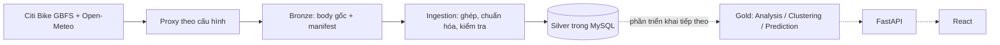

# Phân tầng dữ liệu Citi Bike: Bronze, Silver, Gold

Đây là các tầng logic, không yêu cầu ba database riêng. Giữ MySQL hiện tại, không
đổi tên hay di chuyển các bảng/dữ liệu cũ.

| Tầng | Lưu ở đâu | Ai ghi | Trạng thái |
|---|---|---|---|
| Bronze | File gốc dưới BRONZE_DIR, mặc định data/bronze | Ingestion | Đã triển khai |
| Silver | stations, bike_observations, weather_observations, observation_weather_links | Ingestion | Đã triển khai |
| Điều phối/truy vết | collection_runs, alembic_version | Ingestion/Alembic | Đã triển khai |
| Gold | Các bảng thống kê, cụm và dự đoán riêng trong MySQL | Analysis, Clustering, Prediction | Mới xác định hợp đồng; chưa có bảng/kết quả/service |

Hợp đồng dạng máy đọc: [database/data_layers.json](../database/data_layers.json).



## Bronze: lưu gì và khi nào?

Mỗi kỳ collector nhận một response HTTP sẽ lưu body **trước khi parse JSON hoặc
kiểm tra version/quality**. Giữ nguyên bytes đã được HTTPX giải nén/giải mã HTTP,
không chạy json.dumps để tạo lại body. Đây là payload nguồn, không phải bản ghi
HTTP ở mức gói tin hay các bytes nén trên đường truyền.

Trong một lần chạy bình thường sẽ có discovery, station_information, station_status
và các request weather thật. Từng response retry 429/5xx cũng có file riêng; response
không phải JSON hoặc JSON không hợp lệ vẫn được lưu để điều tra. Lỗi mạng không có
response chỉ được ghi bằng loại lỗi và thời gian, không dựng body thay thế.

Ngoại lệ: response HTTP 407 của proxy không phải dữ liệu nguồn. Chỉ lưu mã lỗi và
nhãn body_omitted, không lưu body có thể phản chiếu thông tin đăng nhập proxy.

Cấu trúc:

```text
data/bronze/
└── citibike/YYYY/MM/DD/                  # ngày của scheduled_at theo UTC
    └── run_<collection_run_id>/
        └── attempt_<attempt_count>_<uuid>/
            ├── manifest.json
            ├── response_0001_<uuid>.body
            └── ...
```

Mỗi body được tạo độc quyền với tên duy nhất; retry không ghi đè file trước.
Manifest đang mở được cập nhật bằng file tạm + atomic replace, có các trường:

- format_version=bronze-v1, source, collection_run_id, collection_attempt, station_ids.
- scheduled_at, started_at, finished_at, received_at của từng response, đều UTC có offset.
- responses: response_id, source, request_attempt, URL không userinfo/query/fragment,
  tọa độ weather yêu cầu, http_status, content_type, body_file, size_bytes, SHA-256.
- network_failures: loại lỗi, thời điểm, tuyến nguồn đã loại thông tin xác thực.
- weather_reuse: weather_observation_id và run gốc nếu dùng lại dữ liệu Silver.
- capture_status=collecting/complete/aborted và planned_silver_status.

Không lưu request headers, proxy URL, tài khoản hoặc mật khẩu vào manifest. Không
in body trong log. `data/` đã bị loại khỏi Git; không tự đưa raw vào tài liệu công khai.

`collection_runs.bronze_manifest_path` trỏ tới manifest của **lần thử gần nhất**, tính
tương đối với BRONZE_DIR. Thư mục của các lần thử cũ vẫn giữ nguyên. Các run trước
migration 0003 có cột này là NULL: không bịa lại raw đã bỏ lỡ trong quá khứ.

Nếu weather còn mới được dùng lại thì không có request/body mới. Manifest ghi liên
kết tới weather/run gốc để truy vết; run gốc trước thời Bronze có thể không có raw.
Lệnh --list-stations chỉ để khám phá, không mở kỳ thu thập, không ghi Bronze/MySQL.
Một run success đã hoàn thành trong cùng kỳ bị bỏ qua và không tạo thêm manifest.

## Tính nhất quán giữa Bronze và Silver

1. Ghi marker running vào MySQL và mở thư mục/manifest cho lần thử.
2. Lưu và fsync body/manifest sau mỗi response, rồi mới cho phép parse/chuẩn hóa.
3. Kết thúc capture trước khi commit transaction chứa quan sát Silver và trạng thái run.
4. Chỉ run MySQL có status success/partial và finished_at mới được công bố cho người đọc.

Nếu không ghi được Bronze (quyền, đầy ổ đĩa, lỗi ghi file), lần thử dừng và rollback
các ghi Silver chưa commit, run được đánh failed nếu MySQL còn truy cập được. Không
âm thầm tiếp tục thành công khi mất bằng chứng raw.

Filesystem và MySQL không có transaction chung. capture_status=complete chỉ xác nhận
thu/lưu raw đã xong; planned_silver_status là kết quả dự kiến, **không chứng minh commit
MySQL thành công**. Trạng thái run trong MySQL là nguồn xác nhận cuối cùng. Khi Silver
rollback, Bronze đã ghi vẫn được giữ. Hard crash có thể để lại manifest collecting,
run running hoặc body chưa được manifest tham chiếu; chúng không được coi là kỳ công bố.

Chưa có tác vụ tự xóa hoặc nén Bronze. Hiện giữ toàn bộ; khi triển khai lâu dài cần
chọn nơi lưu bền vững, theo dõi dung lượng và sao lưu cả BRONZE_DIR lẫn MySQL. Đổi
BRONZE_DIR phải chuyển/sao lưu các thư mục đã có để các đường dẫn tương đối còn hợp lệ.

## Silver: dữ liệu chuẩn hóa có thể dùng

Không đổi tên bảng hiện có:

| Bảng | Trách nhiệm |
|---|---|
| stations | Metadata mới nhất của trạm, khóa source + station_id; capacity riêng với rack_count legacy |
| bike_observations | Quan sát xe/chỗ trả, trạng thái hoạt động, quality, thời gian nguồn/thu thập và run |
| weather_observations | Thời tiết theo tọa độ, đơn vị/interval và hai mốc thời gian |
| observation_weather_links | Thời tiết đã chọn cho một quan sát xe |
| collection_runs | Trạng thái kỳ, số bản ghi/lỗi, metadata nguồn và đường dẫn Bronze |

Silver giữ cả các quan sát missing/invalid/inactive/stale để truy vết. Không coi
dữ liệu thiếu là 0, không coi trạm ngừng cho thuê là trạm bình thường. stations là
metadata hiện tại, không phải lịch sử thay đổi capacity; raw Bronze là nguồn đối
chiếu nếu cần dựng lại metadata lịch sử trong bước xử lý riêng.

Module `shared/repositories/silver.py` cung cấp query dùng chung cho API/service:

- bike_observations mặc định lọc source=citibike, run đã kết thúc success/partial,
  quality=valid, có count và trạm không bị đánh ngừng lắp đặt/cho thuê.
- include_unusable=True cho phép UI đọc và gắn nhãn trạm lỗi/ngừng cho thuê, vẫn
  chỉ đọc kỳ đã hoàn tất. Không dùng tùy chọn này để tính chỉ số thuê bình thường.
- available_at nhận datetime có timezone để truy vấn dữ liệu **đã thực sự có** ở
  thời điểm cắt; lọc thời gian thu thập, thời gian nguồn và thời điểm run hoàn tất.
- observation_weather trả cặp xe/thời tiết, loại weather chưa được thu thập tại
  available_at. Người tính feature vẫn phải kiểm tra NULL, tuổi dữ liệu và đơn vị.

Ví dụ dùng trong service tương lai, không tự khởi chạy service khác:

```python
from shared.repositories.silver import bike_observations

rows = session.scalars(bike_observations(source="citibike", available_at=cutoff)).all()
```

## Gold: Analysis đã có mã, các service khác còn là hợp đồng

Đã triển khai Analysis, model/migration `service_runs` và `analysis_results`, xem
[Data_Analysis.md](Data_Analysis.md). Đã tính trên dữ liệu thật ở chế độ chỉ đọc và
thử publication trên SQLite in-memory; chưa nâng Aiven hoặc ghi Gold trên Aiven,
vì cần cập nhật guard collector GitHub trước. Clustering/Prediction/ML vẫn chưa
triển khai. File data_layers.json mô tả phần đã có mã và phần dự kiến:

| Bảng | Service ghi | Nội dung |
|---|---|---|
| analysis_results | Analysis, 5 phút | Metric theo trạm/cửa sổ, số mẫu, mẫu kỳ vọng và coverage |
| clustering_runs | Clustering, hằng ngày | Phiên, nguồn, cửa sổ, thuật toán/cấu hình, watermark và trạng thái |
| station_clusters | Clustering | Thành viên source + station_id theo phiên, nhãn cụm và đặc trưng |
| predictions | Prediction, 5 phút | input_cutoff_at, issued_at, target_at=t+30 phút, predicted_bikes, model_version_id |
| service_runs (đã có mã); model_versions, training_jobs (dự kiến) | Service/runner tương ứng | Điều phối, truy vết phiên bản và tác vụ, không phải dữ liệu nguồn |

Quy tắc bắt buộc khi triển khai Gold:

- Worker đọc Silver đã hoàn tất, không tự gọi API nguồn và không chạy lồng trong
  collector/FastAPI. Mỗi worker có tiến trình, khóa và watermark riêng.
- Khóa đầu ra luôn chứa source khi gắn với trạm; không trộn Citi Bike và Seoul cũ.
- Kết quả được công bố sau khi phiên tính xong; giữ phiên thành công trước nếu lần mới lỗi.
- Metric chỉ dùng mẫu hợp lệ, ghi sample_count, expected_sample_count và coverage.
  Không tạo giá trị 0 cho nhóm chưa có mẫu. Cách xác định mẫu kỳ vọng/phạm vi trạm
  phải được cấu hình và lưu cùng phiên, không suy từ số dòng đã nhận.
- Prediction chỉ dùng đầu vào biết được tại input_cutoff_at=t; issued_at là lúc tạo
  thực tế, target_at=t+30 phút. Không dùng nhãn hay thời tiết tương lai làm feature.
- Cửa sổ và timestamp lưu UTC. Đặc trưng lịch địa phương dùng America/New_York, xử lý
  DST; không gộp nhầm hai giờ lặp hoặc tạo thêm giờ không tồn tại.
- Thiếu lịch sử thì ghi trạng thái insufficient_data hoặc baseline có nhãn rõ,
  không tạo cụm/metric/dự đoán giả. Chưa có các kết quả này trong dự án hiện tại.

API tương lai đọc Silver cho trạng thái hiện tại/lịch sử và Gold cho các kết quả
đã tính; React không đọc MySQL hoặc raw trực tiếp. Không tự xưng đây là kho dữ liệu
hoàn chỉnh: hiện mới có lưu trữ Bronze, Silver và hợp đồng cho Gold/Data Mart.

## Chạy và kiểm tra trên Windows

```powershell
.\.venv\Scripts\python -m alembic upgrade head
.\.venv\Scripts\python -m ingestion.main --once
```

Tra đường dẫn manifest của run mới:

```sql
SELECT id, source, status, bronze_manifest_path
FROM collection_runs ORDER BY id DESC LIMIT 10;
```

Lấy đường dẫn đầy đủ bằng BRONZE_DIR + giá trị bronze_manifest_path rồi kiểm tra:

```powershell
.\.venv\Scripts\python -m scripts.inspect_bronze "DUONG_DAN_DAY_DU_TOI_MANIFEST_JSON"
```

Thay chuỗi đường dẫn bằng file thật. Lệnh chỉ đọc file và kiểm tra SHA-256/kích thước,
không gọi API và không ghi database. JSON nguồn lỗi vẫn có thể có hash hợp lệ;
json_bodies chỉ đếm body parse được, không chứng minh dữ liệu đã đạt chất lượng Silver.
Chưa triển khai replay tự động từ Bronze vào Silver; có thể đọc lại raw để điều tra,
nhưng không được gắn dữ liệu xử lý lại thành quan sát realtime mới.

## Kết quả kiểm tra thực tế ngày 01/11/2026 (Asia/Bangkok)

Phần này ghi kết quả lịch sử trên Windows. Phương án chạy khi tắt máy được chuẩn
bị trong [hướng dẫn GitHub Actions + Aiven](Deploy_GitHub_Actions_Aiven.md): Silver
ở Aiven, Bronze upload artifact mỗi job, chưa được kiểm tra trên runner thật.
Artifact là bản lưu tạm 7 ngày, cần sao lưu đầy đủ gồm cả raw weather được tái sử
dụng từ run trước. Không xóa Bronze Windows hay thay đổi provenance của run cũ.
Việc commit Silver và upload artifact không phải một transaction chung: chỉ coi
raw đã lên cloud khi bước upload thành công. Không coi retention artifact là
chính sách lưu vĩnh viễn cho kho Bronze/Data Warehouse.

- Migration 0003_bronze đã áp dụng thành công trên MySQL hiện tại; run cũ ID 1 vẫn
  giữ bronze_manifest_path=NULL, không thay đổi dữ liệu cũ để tạo provenance giả.
- Chạy collector mới đúng một lần qua proxy: run ID 2, status success, 5 xe và 5
  weather mới trong Silver; không khởi chạy --schedule.
- Bronze có 8 response HTTP 200: discovery + information + status và 5 weather.
  Tất cả 8 body parse được JSON và vượt kiểm tra kích thước/SHA-256.
- 91 tests passed, gồm raw giữ nguyên bytes, JSON lỗi vẫn được lưu, retry không
  ghi đè, lỗi đĩa chặn Silver, raw còn sau rollback, weather reuse có provenance,
  đọc Silver loại run chưa hoàn tất và dữ liệu weather chưa có tại cutoff.
- Không tạo Gold. Chưa thử mất điện/đầy đĩa trên máy thật hay chạy lịch lâu dài;
  lỗi lưu trữ/rollback được kiểm thử bằng fixture và lỗi dựng trong tests.
- Bằng chứng dạng máy đọc: [bronze_verification.json](bronze_verification.json).
